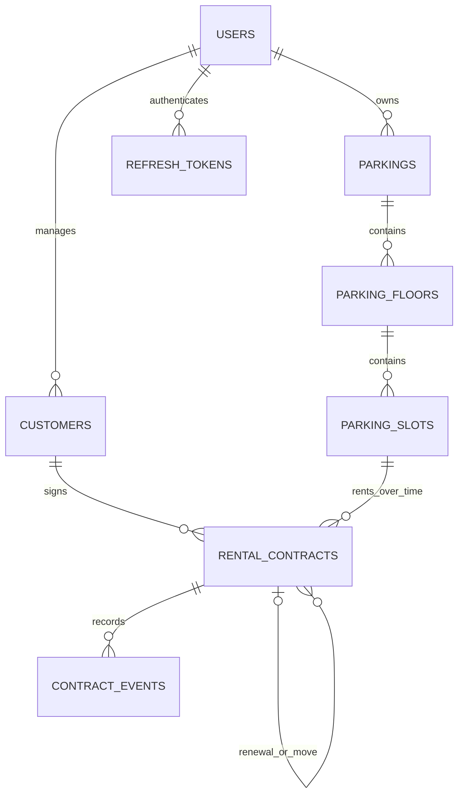

# Parking database design

Primary keys identify rows. Foreign keys require the parent to exist. Combined
foreign keys prove that related records agree on their owner or lot, instead
of trusting separate IDs from a client.

Existing users and refresh_tokens retain their IDs and authentication data.
Parkings require an owner; floors point to a lot; slots point to the combined
lot/floor key. Slot codes use a unique index on (parking_id, LOWER(code)).
Floor numbers are unique per lot. Archiving preserves rows and keeps those
numbers/codes reserved; no cascade deletes erase rental history.

Customers belong to owners. Their case-insensitive codes are unique per owner;
phones are optional text and are not unique. A person can have separate customer
records with different owners. No owner can select another owner's customers.

Contracts reference (owner_id, parking_id), (owner_id, customer_id), and
(parking_id, slot_id). A source-contract link also includes the owner. Their
GiST exclusion constraint prohibits overlapping non-cancelled [start,end) ranges
on one slot. The generated range uses the early-ending time when present.
Ended history still blocks overlapping backdated agreements.

Events store immutable-through-the-API before/after values for agreement changes.
They reference the combined owner/contract key. No API updates or deletes events.
FKs restrict physical deletion of referenced business resources.

Indexes support owner listings, floor lookup, customer search, contract owner/end
queries, current bookings by slot/end, event history, and the exclusion constraint.
No duplicated capacity, occupancy, expiration, or remaining-time columns exist.
The rental_contract_details view calculates current state and duration on read.

All new business timestamps represent instants with TIMESTAMPTZ, like Swift Date.
The contract's timezone and original billing anchor are separate facts used for
calendar months, like choosing TimeZone and Calendar when adding months in iOS.
The original users.created_at remains untouched because its historical timezone
was not established. Old parking creation times remain null rather than invented.

Operational status (usable/maintenance), archive state, and rental occupancy are
different concepts. A future reservation can block a requested period while the
slot is available now. Physical vehicle entry/exit is not tracked by this model.
